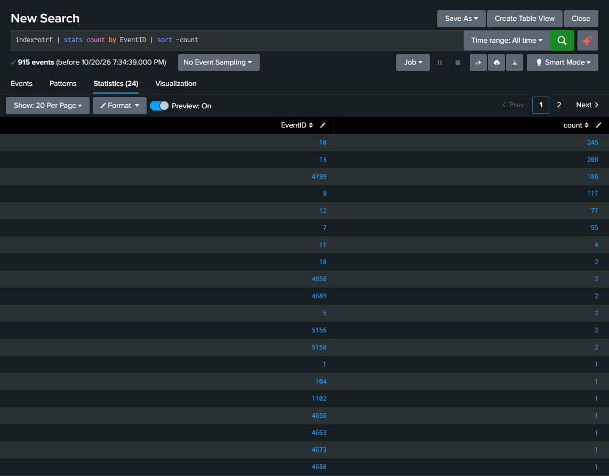
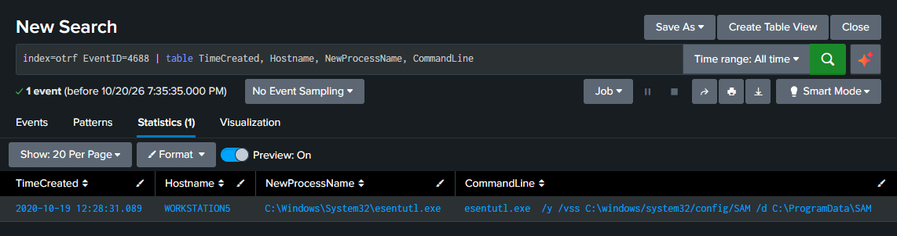
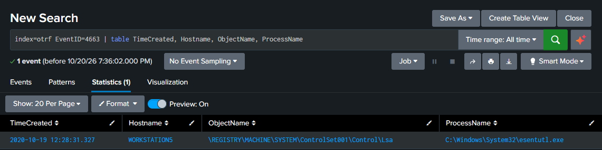
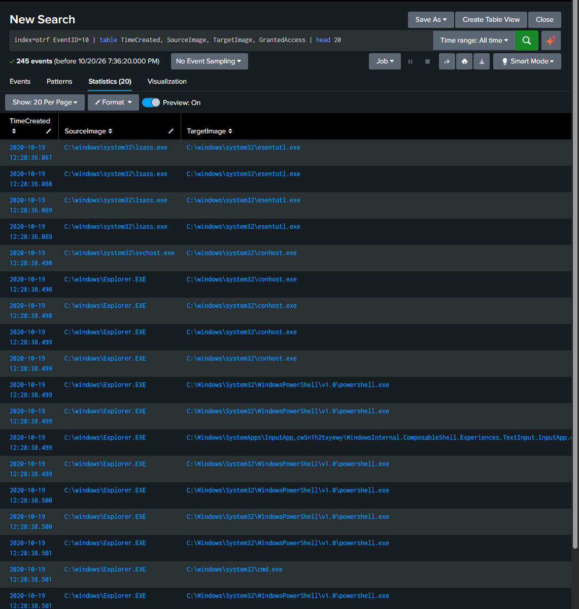
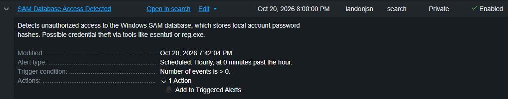

# Home SIEM Lab: Credential Theft Detection with Splunk

## Overview
I built this lab to get hands-on experience with SIEM tooling and real attack data. Using Splunk Enterprise, I ingested and analyzed 915 Windows Security and Sysmon events from the OTRF Security Datasets project, which captures a simulated attacker using esentutl.exe to steal local password hashes from the Windows SAM database. The goal was to understand what this attack looks like in logs and build a detection rule around it.

## Tools Used
- Splunk Enterprise (free license)
- Windows Security Event Logs
- Sysmon (System Monitor)
- OTRF Security Datasets
- MITRE ATT&CK Framework

## What I Was Looking For
**Technique:** OS Credential Dumping via SAM (MITRE ATT&CK T1003.002)

The SAM database stores hashed passwords for local Windows accounts. Attackers use tools like esentutl.exe to quietly copy it, then crack the hashes offline or use them in pass-the-hash attacks. This is a real technique used in the wild, and it's subtle enough that it blends in with normal Windows activity if you're not watching the right event IDs.

## What I Did

### Ingesting the Data
I loaded 915 events from an OTRF atomic dataset into a dedicated Splunk index. The dataset captures the full attack chain including process creation, file access, and process memory access events logged by both Windows Security auditing and Sysmon.

### Event IDs I Focused On
| Event ID | Source | What It Shows |
|----------|--------|---------------|
| 4688 | Windows Security | esentutl.exe being created as a new process |
| 4663 | Windows Security | Direct read access to the SAM database file |
| 10 | Sysmon | lsass.exe repeatedly opening esentutl.exe memory |
| 4799 | Windows Security | Local security group enumeration |
| 1102 | Windows Security | Audit log cleared after the attack |

### What the Logs Showed
The most telling finding was in the Sysmon EventID 10 data: lsass.exe (the Windows credential manager process) was opening esentutl.exe's memory multiple times within a single second. That's not normal behavior. Paired with EventID 4663 confirming a direct read of the SAM file, the attack chain was clear.

EventID 1102 at the end of the dataset was also interesting: the attacker cleared the audit log after completing the theft, which is a defensive evasion move (T1070.001) and something I flagged as a secondary detection opportunity.

### Detection Rule I Built
index=otrf EventID=4663 ObjectName="SAM"

Configured as a real-time Splunk alert:
- Triggers when events > 0 within 1 minute
- Severity: High
- Action: Add to Triggered Alerts

## MITRE ATT&CK Mapping
- **Tactic:** Credential Access (TA0006)
- **Technique:** OS Credential Dumping: Security Account Manager (T1003.002)
- **Defense Evasion:** Indicator Removal: Clear Windows Event Logs (T1070.001)

## Screenshots

### Event ID Breakdown (915 events ingested)

### esentutl.exe Process Creation (EventID 4688)

### SAM Database File Access (EventID 4663)

### lsass.exe Accessing esentutl.exe Memory (Sysmon EventID 10)

### Detection Alert Configuration

## What I Learned
Going through this reinforced how important cross-source correlation is. The Windows Security log alone tells part of the story, but without Sysmon's process access events, the lsass/esentutl relationship would have been invisible. It also made me think differently about log clearing: seeing EventID 1102 at the end of a credential theft sequence is itself a detection signal, not just noise.
